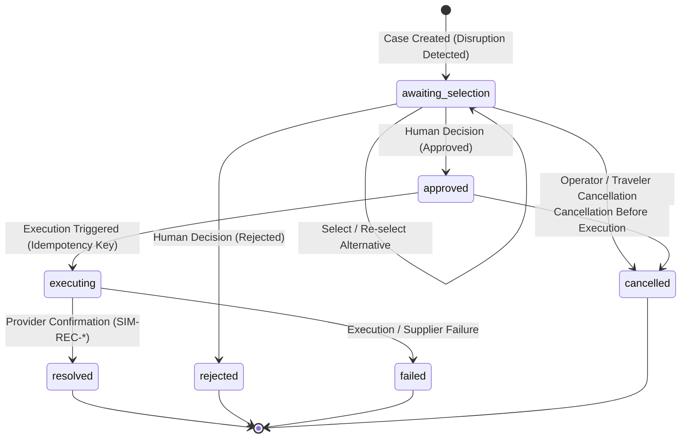

# NAVIQRA Travel Disruption Recovery Lifecycle

NAVIQRA provides an approval-gated, auditable travel disruption recovery lifecycle for autonomous enterprise travel agents. It bridges automated disruption monitoring with human oversight, ensuring that travel modifications and rebookings cannot execute without explicit authorization and immutable audit tracking.

---

## 1. Lifecycle State Machine

The recovery lifecycle enforces strict, deterministic state transitions. Arbitrary state mutations are rejected by both the API layer and the underlying storage engines.



### State Definitions & Valid Transitions

| State | Description | Allowed Next States | Preconditions |
|---|---|---|---|
| `awaiting_selection` | Initial state. Disruption context and candidate alternatives are cataloged. | `awaiting_selection`, `approved`, `rejected`, `cancelled` | Default initial state on creation. |
| `approved` | An alternative was selected and approved by an authorized supervisor or traveler. | `executing`, `cancelled` | Requires a valid `selected_option` and explicit approver identity. |
| `executing` | Rebooking is actively being dispatched to the supplier or sandbox adapter. | `resolved`, `failed` | Requires prior `approved` status and a unique `idempotency_key`. |
| `resolved` | Final state. Rebooking successfully confirmed by provider. | Terminal state | Generates confirmation reference (e.g., `SIM-REC-...`). |
| `rejected` | Terminal state. Proposed alternatives were declined during review. | Terminal state | Requires approver identity and optional justification. |
| `failed` | Terminal state. Supplier rejected fulfillment or downstream error occurred. | Terminal state | Records error diagnostics and supplier metadata. |
| `cancelled` | Terminal state. Disruption resolution cancelled prior to execution. | Terminal state | Permitted only from `awaiting_selection` or `approved`. |

---

## 2. Safety & Governance Guarantees

### Human-in-the-Loop Gate
- Autonomous agents can evaluate disruption impacts and propose candidate alternatives, but **cannot self-execute rebookings**.
- Transitioning to `approved` requires explicit human approval specifying `approver` identity and decision rationale.
- Attempting to execute an unapproved case returns `409 Conflict`.

### Strict Tenant Isolation
- Every recovery case is partitioned by `tenant_id` at the database primary key and index level (`PRIMARY KEY (tenant, case_id)`).
- All requests are authenticated via `X-Tenant-ID` and `X-Tenant-Key` headers. Mismatches between path parameter and authenticated identity fail immediately with `401 Unauthorized`.
- Cross-tenant lookups fail with `404 Not Found`, eliminating information leakage across enterprise boundaries.

### Idempotency & Concurrency Control
- Execution requests require an `idempotency_key` (8–128 characters).
- Replays with the identical `idempotency_key` on the same case return the existing execution result without duplicate execution.
- Reusing an `idempotency_key` across different recovery cases is prevented by database uniqueness checks and returns `409 Conflict`.
- State transitions employ optimistic locking (`UPDATE ... WHERE status = ...`) to prevent race conditions during concurrent approval or execution attempts.

### Truthful Simulation Boundary
- In sandbox and demo environments, NAVIQRA never claims a live external booking occurred.
- Confirmation identifiers are prefixed with `SIM-REC-`.
- Execution responses explicitly state `"live_inventory": false`, `"booking_mode": "simulated_non_bookable"`, and include explicit sandbox notices.

### Immutable Audit Trail
- Every state change, alternative selection, decision, execution attempt, and cancellation writes an append-only event to `audit_events`.
- Recovery audit trails can be retrieved chronologically via `GET /v2/tenants/{tenant_id}/recovery/{case_id}/audit`.

---

## 3. API Reference

All recovery endpoints are located under `/v2/tenants/{tenant_id}/recovery`.

### 3.1 Create Recovery Case
Creates a new recovery case when a disruption is detected.

- **Method**: `POST`
- **Path**: `/v2/tenants/{tenant_id}/recovery`
- **Status Code**: `201 Created`

#### Request Payload
```json
{
  "trip_id": "trip-del-sfo-88",
  "disruption": "Inbound flight cancelled due to severe weather",
  "options": [
    {
      "id": "opt-flight-101",
      "type": "flight",
      "provider": "sandbox",
      "departure": "2026-11-15T09:00:00Z",
      "price": 320.0,
      "currency": "USD"
    },
    {
      "id": "opt-flight-202",
      "type": "flight",
      "provider": "sandbox",
      "departure": "2026-11-15T14:30:00Z",
      "price": 280.0,
      "currency": "USD"
    }
  ],
  "context": {
    "pnr": "XY789K",
    "cabin": "business",
    "vip": true
  }
}
```

#### Example cURL
```bash
curl -X POST "http://localhost:8000/v2/tenants/airline-ops/recovery" \
  -H "Content-Type: application/json" \
  -H "X-Tenant-ID: airline-ops" \
  -H "X-Tenant-Key: local-dev-key" \
  -d '{
    "trip_id": "trip-del-sfo-88",
    "disruption": "Inbound flight cancelled due to severe weather",
    "options": [
      {"id": "opt-1", "price": 320.0, "currency": "USD"},
      {"id": "opt-2", "price": 280.0, "currency": "USD"}
    ]
  }'
```

---

### 3.2 List Recovery Cases
Lists recovery cases for a tenant, optionally filtered by status.

- **Method**: `GET`
- **Path**: `/v2/tenants/{tenant_id}/recovery?status=awaiting_selection&limit=50`
- **Status Code**: `200 OK`

#### Example Response
```json
{
  "cases": [
    {
      "case_id": "7fb5fe64-7b52-4618-b605-b8af7289f6b8",
      "tenant": "airline-ops",
      "trip_id": "trip-del-sfo-88",
      "disruption": "Inbound flight cancelled due to severe weather",
      "status": "awaiting_selection",
      "created_at": "2026-11-10T00:47:18.123456Z",
      "updated_at": "2026-11-10T00:47:18.123456Z",
      "requires_human_confirmation": true
    }
  ]
}
```

---

### 3.3 Get Recovery Case
Retrieves a single recovery case by ID.

- **Method**: `GET`
- **Path**: `/v2/tenants/{tenant_id}/recovery/{case_id}`
- **Status Code**: `200 OK` (or `404 Not Found`)

---

### 3.4 Select Alternative
Selects one of the proposed recovery alternatives.

- **Method**: `POST`
- **Path**: `/v2/tenants/{tenant_id}/recovery/{case_id}/select`
- **Status Code**: `200 OK`

#### Request Payload
```json
{
  "selected_option_id": "opt-flight-101",
  "notes": "Passenger prefers morning departure"
}
```

---

### 3.5 Submit Approval Decision
Records an approval or rejection decision. Cases cannot be approved without first selecting an option.

- **Method**: `POST`
- **Path**: `/v2/tenants/{tenant_id}/recovery/{case_id}/decision`
- **Status Code**: `200 OK`

#### Request Payload (Approval)
```json
{
  "approved": true,
  "approver": "supervisor-dan",
  "notes": "Authorized travel policy exception"
}
```

#### Request Payload (Rejection)
```json
{
  "approved": false,
  "approver": "finance-auditor",
  "notes": "Alternative cost exceeds per-diem recovery threshold"
}
```

---

### 3.6 Execute Recovery
Dispatches execution of an approved recovery alternative.

- **Method**: `POST`
- **Path**: `/v2/tenants/{tenant_id}/recovery/{case_id}/execute`
- **Status Code**: `200 OK`

#### Request Payload
```json
{
  "idempotency_key": "exec-key-92837482",
  "provider": "sandbox",
  "simulate_failure": false,
  "details": {
    "seat_preference": "12A"
  }
}
```

#### Example Response (Truthful Sandbox Execution)
```json
{
  "case_id": "7fb5fe64-7b52-4618-b605-b8af7289f6b8",
  "tenant": "airline-ops",
  "status": "resolved",
  "idempotency_key": "exec-key-92837482",
  "execution_metadata": {
    "idempotency_key": "exec-key-92837482",
    "provider": "sandbox",
    "mode": "simulation",
    "booking_mode": "simulated_non_bookable",
    "resolved_at": "2026-11-10T00:48:00.123456Z"
  },
  "resolution_outcome": {
    "outcome": "simulated_rebooking_confirmed",
    "confirmation_id": "SIM-REC-A7F92B3C10D8",
    "provider": "sandbox",
    "live_inventory": false,
    "booking_mode": "simulated_non_bookable",
    "notice": "Simulated sandbox execution; no live external booking was performed."
  }
}
```

---

### 3.7 Cancel Recovery Case
Cancels a recovery case that is currently in `awaiting_selection` or `approved` state.

- **Method**: `POST`
- **Path**: `/v2/tenants/{tenant_id}/recovery/{case_id}/cancel`
- **Status Code**: `200 OK`

#### Request Payload
```json
{
  "reason": "Traveler arranged alternate transportation independently",
  "cancelled_by": "support-agent-bob"
}
```

---

### 3.8 Retrieve Recovery Audit Trail
Retrieves the complete, chronological list of audit events recorded for a recovery case.

- **Method**: `GET`
- **Path**: `/v2/tenants/{tenant_id}/recovery/{case_id}/audit`
- **Status Code**: `200 OK`

#### Example Response
```json
{
  "case_id": "7fb5fe64-7b52-4618-b605-b8af7289f6b8",
  "events": [
    {
      "event_id": "993a0bd3-6fa4-46e3-8fe5-ec399a9b70bb",
      "actor": "agent_runtime",
      "action": "recovery.created",
      "resource_type": "recovery_case",
      "resource_id": "7fb5fe64-7b52-4618-b605-b8af7289f6b8",
      "created_at": "2026-11-10T00:47:18.123456Z",
      "metadata": {"disruption": "Inbound flight cancelled due to severe weather", "options_count": 2}
    },
    {
      "event_id": "a18b4382-b7e1-4c4f-9e2a-71dd8251e601",
      "actor": "operator",
      "action": "recovery.option_selected",
      "resource_type": "recovery_case",
      "resource_id": "7fb5fe64-7b52-4618-b605-b8af7289f6b8",
      "created_at": "2026-11-10T00:47:45.123456Z",
      "metadata": {"selected_option_id": "opt-flight-101", "notes": "Passenger prefers morning departure"}
    },
    {
      "event_id": "c812d765-a82f-4133-9114-8c889a744cb9",
      "actor": "supervisor-dan",
      "action": "recovery.approved",
      "resource_type": "recovery_case",
      "resource_id": "7fb5fe64-7b52-4618-b605-b8af7289f6b8",
      "created_at": "2026-11-10T00:47:55.123456Z",
      "metadata": {"approver": "supervisor-dan", "decision": "approved", "notes": "Authorized travel policy exception"}
    },
    {
      "event_id": "d04a6211-1123-45cd-8aef-139e76192ac7",
      "actor": "recovery_executor",
      "action": "recovery.execution_started",
      "resource_type": "recovery_case",
      "resource_id": "7fb5fe64-7b52-4618-b605-b8af7289f6b8",
      "created_at": "2026-11-10T00:48:00.123456Z",
      "metadata": {"idempotency_key": "exec-key-92837482", "mode": "simulation", "provider": "sandbox"}
    },
    {
      "event_id": "f5120aef-8899-4c11-b022-771122334455",
      "actor": "recovery_executor",
      "action": "recovery.resolved",
      "resource_type": "recovery_case",
      "resource_id": "7fb5fe64-7b52-4618-b605-b8af7289f6b8",
      "created_at": "2026-11-10T00:48:00.654321Z",
      "metadata": {"confirmation_id": "SIM-REC-A7F92B3C10D8", "provider": "sandbox"}
    }
  ]
}
```

